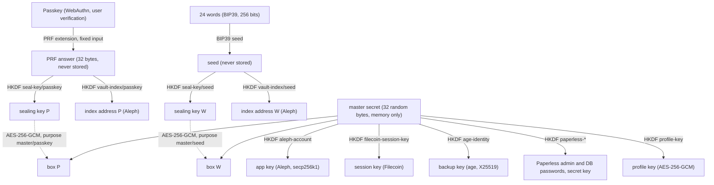
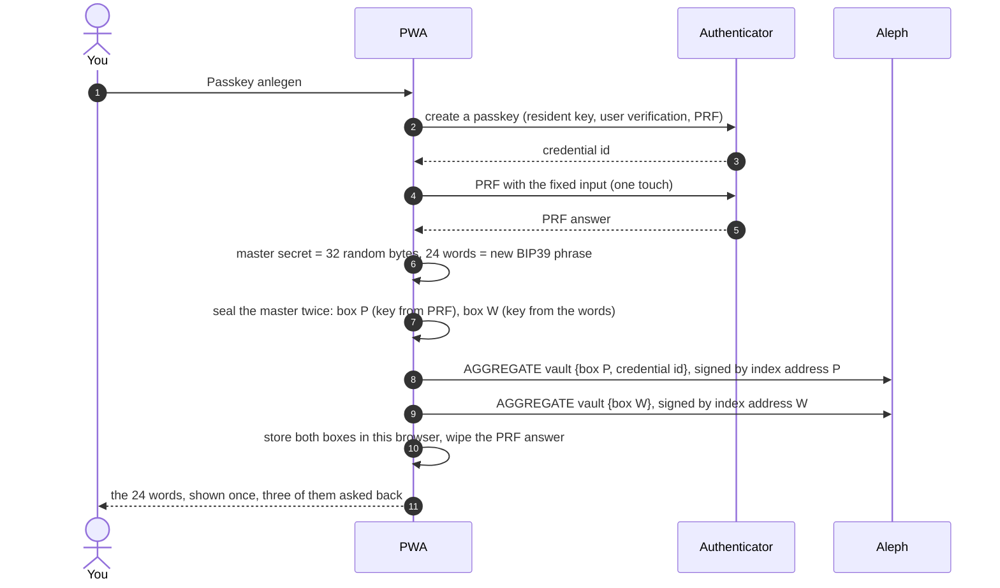
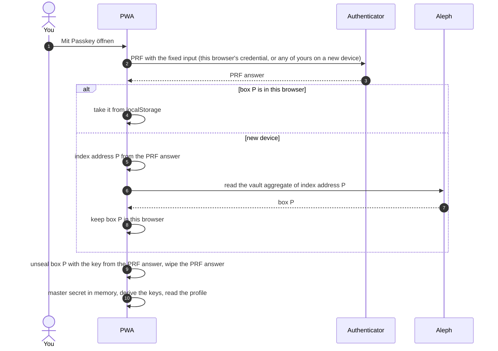
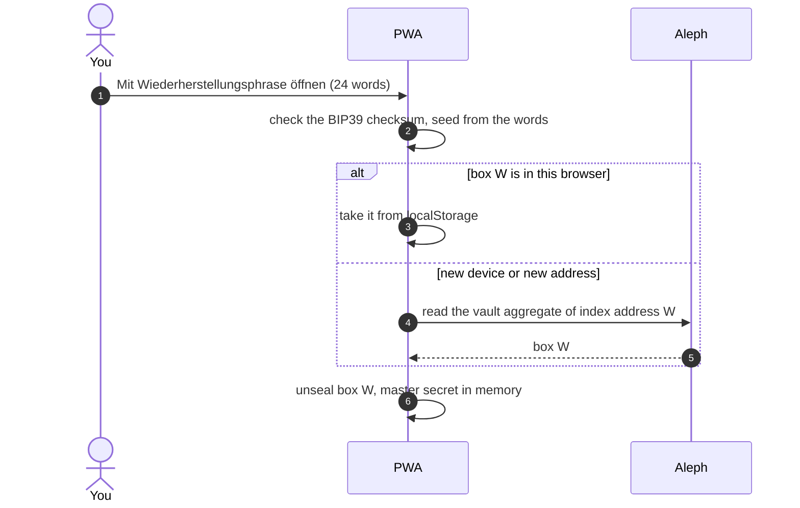
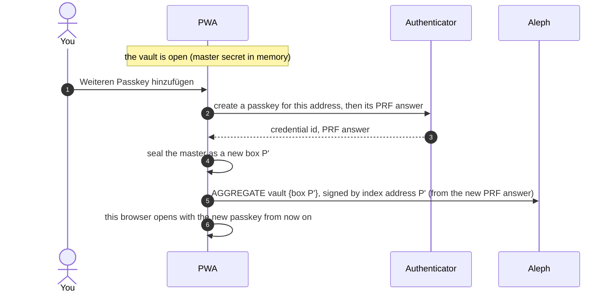

# Keys, money and recovery

What the app keeps, where the money is, and what you need to get back in, or to lose nothing, when a passkey or a device is gone.

## The short version

- **Your money stays in your own wallet** (MetaMask or a hardware wallet): Aleph credits for the VMs and, on Filecoin, tFIL or FIL for gas and USDFC for storage. The app never sees that wallet's key.
- **The app's own addresses hold no money.** Never send anything to them. They act for your wallet, with rights you can take back.
- **The 24 words are the vault.** With them you open it on any device and any address, and they decrypt every backup the app made. Keep them on paper, away from your devices.
- **A passkey is a convenience.** It belongs to one address (`localhost` today, the hosted app later) and one authenticator. Losing it costs nothing as long as you have the 24 words.

## What exists, and where

| What | Where it lives | Holds money? | If it is lost |
|---|---|---|---|
| **Paying account** (your wallet) | MetaMask / hardware wallet, with its own seed | **yes**: credits, tFIL/FIL, USDFC | the wallet's own seed restores it; the app plays no part |
| **Master secret** | sealed twice, in this browser and on Aleph: by each passkey and by the 24 words | no | open it with the 24 words |
| **Passkey(s)** | your YubiKey or another authenticator, one per address | no | open with the 24 words, add a new passkey |
| **24 words** | on paper, with you | no | open with a passkey and create a new vault, or keep using the passkey; see below |
| **App key** (Aleph) | derived from the master secret | **no** | gone with the master secret; revoke it in step 2 |
| **Filecoin session key** | derived from the master secret | **no** | revoke it in step 3, or let it expire (30 days) |
| **Backup key** (age) | derived from the master secret | no | the 24 words derive it again |
| **VM backup key** (backups paid through Le Space Credits) | derived from the master secret; goes to the attested VM only | **no** | the 24 words derive it again; Le Space Credits accept at most 5 per account |
| **Paperless passwords** | derived from the master secret | no | the 24 words derive them again |

## The vault, step by step

Code: `pwa/src/lib/keys/` (`passkey.js`, `seal.js`, `index-keys.js`, `vault.js`, `derive.js`, `age.js`).

### What comes from where

One **master secret**: 32 random bytes, made once when the vault is created. Every key the app uses is derived from it by HKDF-SHA256 with its own label, so the same master secret always gives the same keys and one key reveals nothing about another. The master secret itself is only ever stored **sealed**, twice.

### Why a passkey can unlock at all

A passkey normally only signs a random challenge, and a signature is different every time, so it cannot serve as a key. The **PRF extension** of WebAuthn (`hmac-secret` in the authenticator) adds what a key needs:
- each passkey holds a secret of its own that never leaves the authenticator;
- given a fixed input, it returns an HMAC of it: 32 bytes, **the same every time** for the same passkey and the same input.

The app always asks with the same fixed input (the SHA-256 of `paperless-anywhere/prf/master/v1`, `passkey.js`). At creation it seals the master secret under a key derived from that answer (box P). To open, it asks again, gets the same 32 bytes, derives the same key and unseals box P. On a new device the same answer also gives index address P, where box P is found on Aleph.

Limits that keep this safe:
- The passkey answers only after **user verification** (fingerprint, face, PIN).
- It answers only **to the address it was made for** (its relying party), so another site never gets this value.
- The app wipes the answer right after use.
- **Each passkey gives a different value**, which is why every added passkey gets its own box.
- A **synced passkey** (an iCloud keychain or Google password manager passkey) carries its secret along, so it opens the vault on every device of that account.
- Without PRF there is no unlock, and the app says so ("Dieser Passkey kann kein PRF"). Current Chrome, Edge, Safari and Android support PRF, and so do YubiKeys from the 5 series.

### Where it is stored

| What | Where | In what form |
|---|---|---|
| master secret | **memory only**, while the vault is open | plain, wiped on lock or when the page closes |
| PRF answer, 24 words, derived keys | **memory only**, for the step that needs them | the PRF answer is wiped right after use |
| box P (master sealed by the passkey) | this browser (`localStorage`) **and** Aleph, aggregate `paperless-anywhere-vault` under index address P | AES-256-GCM |
| box W (master sealed by the words) | this browser **and** Aleph, aggregate `paperless-anywhere-vault` under index address W | AES-256-GCM |
| the passkey's private key | the authenticator (phone, laptop, YubiKey, or a synced passkey store) | never leaves it |
| the profile (setup) | Aleph, aggregate `paperless-anywhere-profile` under the app key, see "Where the setup is kept" | AES-256-GCM |

### Create

### Open with the passkey, on this or a new device

### Open with the 24 words

### Add a passkey (a new address or a second authenticator)

**Lock** wipes the master secret from memory. **Diesen Browser vergessen** also removes the boxes from this browser; those on Aleph stay, so the passkey or the words still open the vault elsewhere.

### Getting back in

| Lost | What still works |
|---|---|
| a passkey or a device | another passkey, or the 24 words: open, then add a new passkey |
| this browser's data | the passkey or the words, from box P or W on Aleph |
| the 24 words, passkey still there | everything works. The words cannot be shown again: they are random and not derived from the master. Keep them on paper from the start. |
| all passkeys **and** the words | the vault is gone: the app key, the backup key (backups made with it cannot be decrypted), the Paperless passwords. Your money is not affected. Revoke the app key in your wallet (setup, step 2). |
| the boxes on Aleph **and** in every browser | the 24 words alone do not help: they open box W, they do not compute the master secret. The boxes on Aleph are kept as long as Aleph keeps aggregates. |

### The VM's data area: a key nobody has

The encrypted image is the same for every VM that uses it, so its disk key is too; each image version has a key of its own, which the app stores together with the image's hash. What a VM writes (documents, database, exports, Docker's images, Caddy's certificate key, the generated passwords) therefore goes into a **data area** sealed with a key of its own. At boot, the VM makes a random 512-bit key in memory and seals the area with it (dm-crypt, AES-XTS, `paperless-data-disk` in the image). The key never leaves the VM: not to the app, not to the profile, not to the node. That is enough, because the data lives one session (restored from the backup at the start, erased at the stop). What lasts is the backup, sealed with the backup key from the vault.

The area is a file on the image's disk, as large as the free space minus 2 GiB. The guest kernel has no loop driver to open a file as a disk, so the VM allocates the file without writing it, looks up where its blocks lie on the disk under the image's encryption, and maps exactly those blocks with dm-linear; dm-crypt goes on top of that. What lands there is encrypted with the VM's own key only. Read through the image's filesystem, the file stays empty. (A second, empty disk from Aleph would serve as well, and the image still takes one, but Aleph's measured boot picks its root disk by name, and with two disks a VM sometimes did not start; the app asks for none.)

The app shows whether a running VM sealed its data area. An older image without this writes to the image's disk and says so.

### Why the boxes can be public on Aleph

- **Only sealed data is there.** Box P and box W are AES-256-GCM ciphertexts. Their keys come from the passkey's PRF answer (32 bytes from the authenticator, released only to this site's origin and only after user verification) or from the 24 words (256 bits of entropy). Neither can be guessed.
- **A changed box does not open.** AES-GCM is authenticated, and the purpose (`master/passkey`, `master/seed`, `profile`) is bound in as additional data, so a box cannot be passed off as another.
- **Only the key holder can write there.** An Aleph aggregate belongs to the address that signs it. Index address P comes from the PRF answer and index address W from the words, so nobody else can put a box under them. The same holds for the profile under the app key.
- **The index addresses say little.** They are derived per passkey and per phrase and carry no name or wallet. The profile under the app key is linked to the paying account, because the wallet's `security` aggregate authorizes the app key.
- **What Aleph could still do:** not serve a box (then the copy in this browser or the other secret opens the vault), or serve an older version of the profile. Neither reveals anything. Both are availability questions, not confidentiality.

## Where the setup is kept

Everything the app needs on every device is in a **profile**, saved with every change in the setup (and after a start or a stop). It lives **on Aleph**, not in the browser, so any device that opens the vault (passkey or 24 words) finds the same setup.

**Encrypted in the browser before it leaves:** AES-256-GCM, with a key derived from the master secret (HKDF-SHA256, label `paperless-anywhere/profile-key/v1`) and the purpose `profile` bound in as additional data (`pwa/src/lib/profile.js`, `keys/seal.js`). Without the master secret, nobody can open it: not Aleph, not a node, not this website.

**What is inside:**
- the paying account and the network;
- the attest relays;
- the image, the node, and the image's passphrase;
- the backup settings and copies, the backup wallet, and the backup key (age);
- the running VM (instance, node, address, measurements);
- the last backup and this vault's own backups.

**What Aleph sees, publicly:**
- an aggregate `paperless-anywhere-profile` under the app key's address (channel `paperless-anywhere`), holding a box of a certain size;
- when it changed, since every save is a new message;
- that the paying account authorized the app key. That is in the wallet's own `security` aggregate, so the link between the paying account and the app key is public. The content is not.

**In the browser:** only the master secret, sealed by the passkey and by the 24 words, under `localStorage`. The profile itself is not stored there. Opened keys are kept in memory only, until the app is locked or closed.

## Why the app's addresses hold no money

The **app key** and the **session key** are delegates:

- **Aleph:** your wallet authorizes the app key once (setup, step 2) to start and delete VMs and to set their port forwards **on behalf of your wallet**. The VMs are paid from your wallet's credits. Measured: the owner pays, the delegate holds nothing.
- **Filecoin:** your wallet authorizes the session key for 30 days (step 3) to create data sets and add backups. Storage is paid from your wallet.

Both rights can be taken back from your wallet at any time: "Freigabe zurücknehmen" (step 2) and "Zurücknehmen" (step 3). After that the keys can do nothing, whoever has them.

## Passkeys and addresses

A passkey is bound to the address of the app that created it: one made on `http://localhost:5180` does not open the app on `https://paperless.example`. One vault can have several passkeys:

1. Open the app on the new address (or the second device) with the **24 words**.
2. "Weiteren Passkey hinzufügen" → "Passkey für … anlegen".
3. From then on that browser opens with the new passkey. The old ones keep working where they were made.

Each passkey's sealed copy of the master secret lives on Aleph under an address that only that passkey leads to, so any of them finds the vault on a new device.

## The 24 words

They are shown once, when the vault is made, and the app asks three of them back before it continues, so they cannot be clicked past. They:

- open the vault on any device and any address, without a passkey;
- derive the **backup key**, so every backup the app made can be decrypted from the words alone, even if the profile on Aleph were gone;
- derive the app key and the Paperless passwords.

They do **not** give access to your money: that is your wallet's own seed.

## The backup key

Backups are encrypted with age before they leave the VM. By default the app uses **the vault's own key**, derived from the master secret: the setup shows "der Schlüssel des Tresors".

An existing key can be pasted instead, for example the one the Mac's backups were made with. The app then says "eingefügt": that key is **not** in the 24 words and must be kept separately, or the backups made with it are lost with it.

A backup can also be fetched and decrypted without a VM: [fetching a backup yourself](restore-yourself.md).

## What to do when …

| Situation | What to do | What is lost |
|---|---|---|
| A passkey is lost or broken | open with the 24 words, add a new passkey; optionally forget this browser on old devices | nothing |
| You move to another address (hosted app) | open there with the 24 words, add a passkey | nothing |
| A device is lost (locked) | nothing urgent: the vault needs a passkey or the words. To be sure, revoke and re-grant steps 2 and 3 | nothing |
| The 24 words are lost, the passkey still works | open with the passkey, make a new vault, move the settings, revoke the old app key; back up again under the new key | nothing, if done while the passkey works |
| Passkey **and** 24 words are lost | revoke steps 2 and 3 from your wallet | **the backups made with the vault's key**; your money is untouched |
| Your wallet's seed is lost | that is the wallet's own recovery | the money in it; the app cannot help |

## Limits, for now

- The image's disk passphrase is shared by every VM made from the same image. A passphrase per person, derived from the master secret, is in preparation: [your own image](own-image.md).
- Backups from the app go to Filecoin **Calibration** only. On mainnet the Mac stays the only writer until the app has been tested with real backups.
