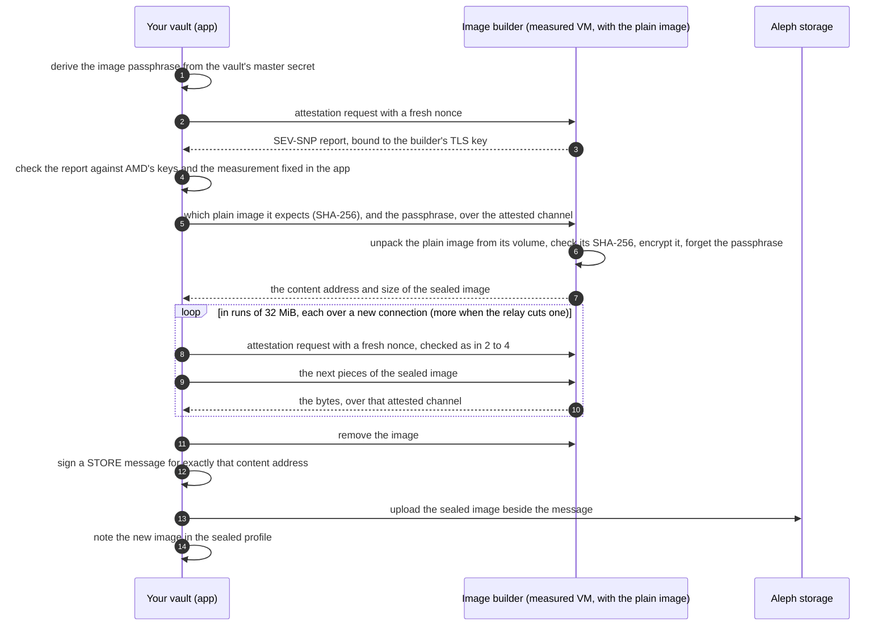
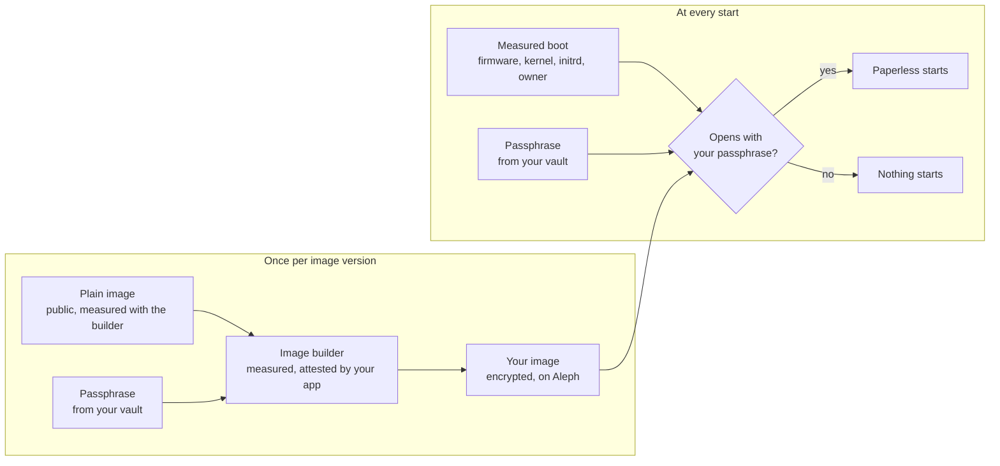

# Your own image

> **Status: in the app.** The setup offers the choice between the public
> image (one passphrase per image version, as [keys and recovery](keys-and-recovery.md)
> describes) and an image of your own. The builder's volumes are published
> on Aleph and fixed in the app; each build starts a builder from them and
> forgets it afterwards. A whole round (build in a browser, VM, backup,
> restore) passed on Aleph (see the end).

A VM of Paperless anywhere boots from an encrypted image. The measured part
of the boot (firmware, kernel, initrd) opens that image with a passphrase the
app hands over after the attestation, and then starts what it finds inside.

With an image of your own, that passphrase comes from your vault and nobody
else has it. (How this compares with a shared passphrase and with a
measured root filesystem: [the variants](confidential-vm-variants.md).) The disk your VM opens is then the image that was sealed for
you, and nothing else: a disk that was not sealed with your passphrase does
not open, and the VM does not start.

## The pieces

| Piece | What it is | Who can check it |
|---|---|---|
| The plain image | Debian, Docker, Caddy, the scripts: what `rootfs/build-image.sh` builds. It holds no secret and is public on Aleph. | Everyone: its SHA-256 is fixed in the app and printed by the build. |
| The image builder | A small service that encrypts the plain image with a passphrase it is given. It runs in a confidential VM whose whole content is measured (an Aleph V-PROGRAM), the plain image included: it lies on a verified volume. | Everyone: its launch measurement is fixed in the app and can be recomputed from the published volumes (checked against their root hashes) and Aleph's runtime. What the volumes hold can be read and compared with this repository; a rebuild from it does not give the same bytes. |
| Your app | Derives the passphrase from your vault, checks the builder's attestation, fetches the sealed image and stores it on Aleph. | You. |
| Your image | The plain image, encrypted with your passphrase, stored on Aleph under your vault's address. | Only your vault can open it. |

A V-PROGRAM is a closed box: its guest firewall lets nothing in but the
attested port, the replies to outbound connections included. The builder
therefore fetches nothing and uploads nothing. What it seals is measured,
and what it made leaves only through the attested channel.

## How an image is made



Steps 2 to 4 are the same check the app makes before it unlocks a Paperless
VM ([workflow, section 3](workflow.md#3-attestation-and-unlock-in-detail)):
no passphrase leaves the app before the hardware has confirmed what runs on
the other side. The sealed image holds nothing readable without the
passphrase, so it may pass through a relay and lie on public storage.

## The step in the app

In the setup, the image step asks which image (once a builder is fixed in
the app):

- **The public image from Le Space**: one passphrase per image version,
  entered with the image's hash. Le Space knows it, and everyone using that
  version.
- **My own image**: **Build my image** (`pwa/src/lib/own-image.js`).
  Nobody but your vault knows the passphrase. Until it is built, the VM
  starts from the public image, and the step says so. Going back to the
  public image asks for its hash and passphrase anew.

For the own image, the app

1. derives the passphrase from the master secret, under its own label and
   the plain image's SHA-256, so the 24 words alone give it back;
2. opens an attested channel to the builder and sends the build request;
3. fetches the sealed image back and has the builder remove it, in runs of
   32 MiB, three side by side, each over a connection that is attested like
   the first. An attest relay carries 4 MiB per connection and direction,
   and a connection for two minutes; a relay that lists the builder's
   workload carries 256 MiB for ten minutes (relay-button's attest-relay,
   `ATTEST_RELAY_BUILDER_ROOTHASHES`). Where the relay or the line cuts a
   connection, the run goes on from its last piece over a new one, attested
   again. Only tries without a single piece count against it. A connection
   whose attestation does not show the builder's measurement ends the build;
4. signs a STORE message for the image's content address, as the app's own
   address, which also pays the storage, and uploads the image to Aleph;
5. waits until Aleph has processed it, and saves the image's hash and the
   passphrase in the sealed profile, with the measurement the hardware
   reported for the builder and the time of that check.

If the upload fails, the fetched image stays in the open window: a second
try uploads it again, and builds nothing.

While Paperless runs, the step is disabled: a running VM belongs to the
image it started from. Moving a running Paperless to an image of its own:
**Back up and stop**, build, start again; the start restores the newest
backup. If that restore fails, the new VM makes no backup (see
[the workflow](workflow.md#4-stop-last-backup-then-erase)) and the app offers
only to delete it without one (after asking), so the last backup stays the
newest.

## Why the VM can only start your image



Two checks by hardware, one secret between them:

1. The **builder** is measured as a whole (its firmware, kernel, initrd, and
   through dm-verity root hashes on the boot line also its root filesystem
   and its workload). The app accepts one measurement only, so the passphrase
   reaches the code in this repository and no other.
2. The **Paperless VM** is measured up to the initrd that opens the disk, as
   today. That initrd accepts the passphrase only with the owner's signature.
3. The **passphrase** exists in your vault, for the minutes of a build in the
   builder's memory, and at a start in your VM's memory.

## Who knows the passphrase

| | Knows it |
|---|---|
| Your vault | yes: it derives it, under its own label, from the master secret |
| The image builder | during one build, in memory; it goes to `cryptsetup` on standard input and is in no file, no log and no answer |
| Your VM | at boot, to open the disk; the VM zeroes it afterwards |
| Le Space | no |
| The node that runs the builder or your VM | no: both run in SEV-SNP guests |
| GitHub, the build workflow | no |
| Another person using Paperless anywhere | no |

## What can be compared in public

- **The plain image:** one SHA-256 for everyone. The build prints it, the app
  names it, and anyone can download the image and hash it.
- **The builder:** one launch measurement for everyone, computed from the
  runtime Aleph publishes and the builder's root hashes. The app shows the
  one it accepts.
- **Not the encrypted image:** it differs for every person, because the
  passphrase and the random disk key differ. Its hash says nothing to anyone
  else, and nothing checks it at boot. What makes it yours is that it opens
  with your passphrase.

The encryption (LUKS2, AES-XTS) keeps the content secret and makes it
impossible to craft content without the passphrase. It does not notice
blocks that were damaged on purpose: such a VM fails or misbehaves, but it
cannot be made to run a chosen program.

## Checking what your image is made from

The app shows, beside "Build my image", the values it has fixed: the
plain image's SHA-256 and where it lies on Aleph, the commit it was built
from, the builder's V-PROGRAM and its measurements. With them, anyone can
check each link of the chain:

1. **The plain image is the one the app names.** Download it and hash it:

   ```sh
   curl -fsS https://api2.aleph.im/api/v0/messages/<plain STORE hash> | jq -r '.message.content.item_hash'
   curl -fL https://api2.aleph.im/api/v0/storage/raw/<that hash> | gunzip > paperless-plain.ext4
   sha256sum paperless-plain.ext4
   ```

   The image lies on Aleph gzipped; the SHA-256 is that of the image itself.

2. **It was built from this repository.** The image workflow's summary names
   the commit, and for an image built since this repository is public, GitHub signs that the
   file with this SHA-256 was built by that workflow at that commit:

   ```sh
   gh attestation verify paperless-plain.ext4 --repo Le-Space/paperless-anywhere
   ```

   The build is not reproducible bit for bit (Debian packages are fetched at
   build time, without a snapshot, and files carry the build's times), so a
   rebuild gives the same content with another hash. What it holds can be
   read: it is an ext4 image, `rootfs/build-image.sh` says what goes in. The
   same holds for the one-layer container images the VM pulls
   (`rootfs/images.txt`, flattened by `flat-images.yml`; `docker export`
   keeps times) and for the builder's image archive: they are pinned by
   digest or root hash, and what can be compared is their content, not their
   hash against a rebuild.

3. **The builder is the one the app names.** Its V-PROGRAM message on Aleph
   names the runtime, the workload volume and the measurements;
   [`builder/vprogram/`](../builder/vprogram/README.md) says how to verify the
   volume and call the builder attested.

4. **Your image was sealed by that builder with your passphrase.** That is
   what the app's attestation before the build and your VM's start show: a
   disk not sealed with your passphrase does not open.

## The builder's interface

It listens on `127.0.0.1:8080` in its VM; Aleph's attestation agent is the
only way in and forwards from the attested TLS port.

| Call | Does |
|---|---|
| `GET /` | Says what it is and, after the first build, the SHA-256 and size of the plain image it holds. |
| `POST /build` `{sha256, passphrase}` | Unpacks the plain image from its volume, refuses unless its SHA-256 is `sha256`, encrypts it. Answers `{job}` at once. |
| `GET /job/<job>` | `{state}`: `building`, `built` (with the content address and size), `failed` (with the reason). |
| `GET /job/<job>/image` | The sealed image; with `Range: bytes=a-b` one piece of at most 16 MiB. |
| `DELETE /job/<job>` | Removes the image. |

It builds one image at a time, reaches nothing outside itself, holds no key
of its own, and removes an image nobody touched for 30 minutes.

## What it costs

One build per image version and person: a few minutes of building, then
fetching the sealed image from the builder and uploading it to Aleph, a
little under 900 MiB each way, and the storage of that image on your
vault's address as long as you use that version. An older image can be
forgotten once the new one has started.

The builder runs only for a build ([a builder for each build](#a-builder-for-each-build)):
about 15 minutes, paid by the app's address like the image's STORE. Its
volumes stay published, since the measurement belongs to them. A new plain
image needs new volumes and so a new measurement in the app, since the
image is part of what is measured.

## Publishing the plain image

The image workflow (`rootfs.yml`) does it with the option **plain**: it
converts the image as for an encrypted one, publishes it as a STORE of its
own and prints the STORE's hash and the image's SHA-256 in the run's
summary. The builder is published for exactly that image (the workflow
*Image builder on Aleph* takes the two values), and the app shows them.

## Trying the builder

```sh
cd builder
npm test                                  # the rules above, without a container
docker build -f Containerfile -t image-builder .
docker run --rm --network none -v "$PWD/check-container.mjs:/opt/builder/check-container.mjs:ro" \
  image-builder node check-container.mjs  # one whole job, without any network, as on Aleph
```

## Before it goes live

- **Measured** (2026-11-14, workflow *Paperless round trip* with an image
  of its own): the app's code, run on a GitHub runner, had a published
  builder seal the image, fetched 868 MiB through Le Space's relay in about
  10 minutes (1.4 MiB/s, every connection attested) and uploaded it in under
  a minute. A VM started from it, unlocked with the derived passphrase,
  backed up, and a second VM from the same image restored that backup.
- **In a browser** (2026-11-14, `roundtrip.yml` with `own_in_browser`):
  Chromium ran the setup's code with the builder fixed in the app. Starting
  the builder until it answered took 238 s, sealing 24 s, fetching 868 MiB
  through Le Space's relay into the page 534 s, and uploading from the page
  94 s, about 15 minutes in all. Both VMs of the round trip booted from that
  image, and the backup was restored. A build paid through a Le Space
  package has not run yet.
- **In real use** (2026-11-16): a one-part backup made with the public
  image was restored in full in an own image (build paid by the app's
  address).
- **The builder fixed in the app** (`BUILDER` in
  `pwa/src/lib/own-image.js`) was published on 2026-11-14 for the plain
  image `9c32bd…` (release image `e85b9c9a…`) and deleted again; its volumes
  stay. A new plain image needs a new publication and a new `BUILDER`.

## A builder for each build

A builder that runs all the time costs about 0.10 USD an hour. Instead, the
app fixes the builder's V-PROGRAM *content* (runtime, workload and volume
with their root hashes, resources, the node) and starts a builder from it
for each build (`buildOnOwnBuilder`):

1. it signs a V-PROGRAM with that content, as the app's address (which pays,
   as for the image's STORE), notes it in the sealed profile and publishes
   it; Aleph starts it on the node;
2. it waits until the builder answers attested (about four minutes) and
   builds as above;
3. it forgets the V-PROGRAM, also when the build failed, and removes the
   note. A window closed in between leaves the note: the next opening of
   the setup forgets that builder.

The measured boot line holds the runtime, the root hashes and the
resources, not the message's own hash, so every V-PROGRAM with that content
shows the measurement fixed in the app. Tried on Aleph on 2026-11-14: a
second V-PROGRAM on a published builder's volumes showed the first one's
measurement and sealed the real image
([#202](https://github.com/Le-Space/paperless-anywhere/issues/202)).

**Who pays.** With a Le Space package, the Le Space Credits balance
does (model A): each build is charged to it, separately from the plan
price, and needs a running plan. In a voucher period, builds are
included until one succeeds (up to 3 tries); the setup then says so
instead of a price. The app always reports a build's end
(`/v1/image/build/done`), also after a failure or a closed window. The setup shows the price of one build first, the
builder's runtime taken from the Credits balance, and asks. The service
then charges it and grants the customer's Le Space sub-account what
Aleph's one-day check needs. The app's key, allowed by the sub-account to
send `V-PROGRAM`, `STORE` and `FORGET` for it, starts the builder and
stores the image there. After the builder's FORGET it tells the service
(`/v1/image/build/done`), which takes back the rest of its grant. If Aleph
never took the builder, the charge is undone. The image's storage is
included.

Without a package, the app's address pays from its own Aleph credits.
Aleph starts a V-PROGRAM only when its payer holds a day of everything it
then pays for: the builder (about 2.05 million credits a day, measured
2026-11-14), the image's storage and what the address already pays. The
setup reads that before it offers **Build my image**; without enough
credits it says so instead.

The volumes (workload, plain image, their hash trees) stay published: they
are what the measurement belongs to. Deleting a V-PROGRAM forgets the
message only; the workflow's action **delete** with **forget_volumes** also
forgets the volumes of a builder that is not the fixed one. It forgets only
the STOREs that V-PROGRAM names, of the same account, smaller than any image
(600 MiB), and not named in `own-image.js` or a release; one refusal forgets
none of them (`pwa/src/lib/forget-guard.js`). There is no way to forget a
hand-written list of STOREs: on 14 Nov 2026 such a list also forgot older
Paperless images, one of which a vault still started from. A build takes
about 15 minutes and roughly 0.03 USD of builder time, plus the upload.
- The landing page and the security model say so once all of this is true.
