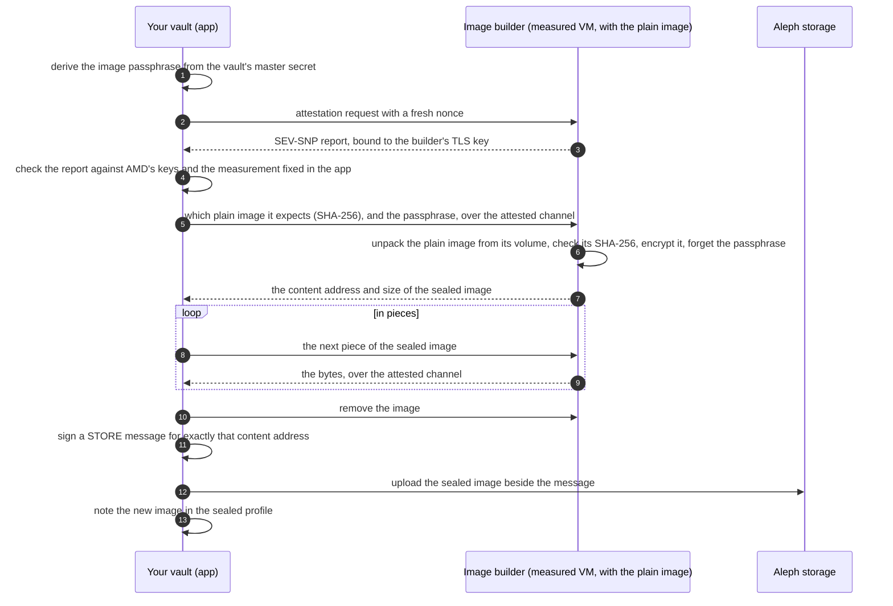
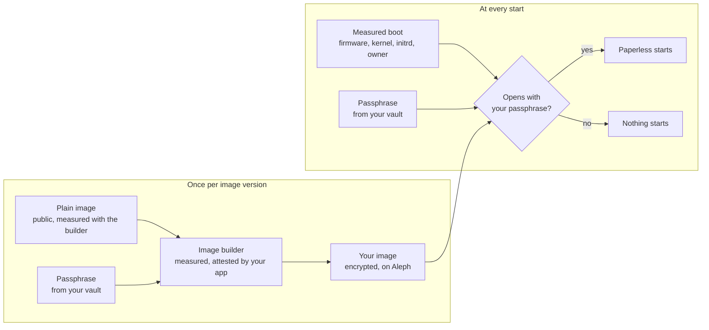

# Your own image

> **Status: in preparation.** The image builder exists
> ([`builder/`](../builder/)), has been published on Aleph, verified by
> attestation there, and has sealed the real image there in a trial. The
> app's step is written, but the app names no builder; the list at the end
> says what is missing. Until then every image version has
> one passphrase, as [keys and recovery](keys-and-recovery.md) describes.

A VM of Paperless anywhere boots from an encrypted image. The measured part
of the boot (firmware, kernel, initrd) opens that image with a passphrase the
app hands over after the attestation, and then starts what it finds inside.

With an image of your own, that passphrase comes from your vault and nobody
else has it. The disk your VM opens is then the image that was sealed for
you, and nothing else: a disk that was not sealed with your passphrase does
not open, and the VM does not start.

## The pieces

| Piece | What it is | Who can check it |
|---|---|---|
| The plain image | Debian, Docker, Caddy, the scripts: what `rootfs/build-image.sh` builds. It holds no secret and is public on Aleph. | Everyone: its SHA-256 is fixed in the app and printed by the build. |
| The image builder | A small service that encrypts the plain image with a passphrase it is given. It runs in a confidential VM whose whole content is measured (an Aleph V-PROGRAM), the plain image included: it lies on a verified volume. | Everyone: its launch measurement is fixed in the app and can be recomputed from this repository and the plain image. |
| Your app | Derives the passphrase from your vault, checks the builder's attestation, fetches the sealed image and stores it on Aleph. | You. |
| Your image | The plain image, encrypted with your passphrase, stored on Aleph under your vault's address. | Only your vault can open it. |

A V-PROGRAM is a closed box: its guest firewall lets nothing in but the
attested port, the replies to outbound connections included. The builder
therefore fetches nothing and uploads nothing. What it seals is measured,
and what it made leaves only through the attested channel.

## How an image is made



Steps 2 to 4 are the same check the app makes before it unlocks a Paperless
VM ([workflow, section 3](workflow.md#3-attestation-and-unlock-in-detail)):
no passphrase leaves the app before the hardware has confirmed what runs on
the other side. The sealed image holds nothing readable without the
passphrase, so it may pass through a relay and lie on public storage.

## The step in the app

In the setup, beside the image's hash and passphrase: **Mein Image bauen**
(`pwa/src/lib/own-image.js`). The app

1. derives the passphrase from the master secret, under its own label and
   the plain image's SHA-256, so the 24 words alone give it back;
2. opens an attested channel to the builder and sends the build request;
3. fetches the sealed image back in pieces over that channel and has the
   builder remove it;
4. signs a STORE message for the image's content address, as the app's own
   address, which also pays the storage, and uploads the image to Aleph;
5. waits until Aleph has processed it, and saves the image's hash and the
   passphrase in the sealed profile.

While Paperless runs, the step is disabled: a running VM belongs to the
image it started from.

## Why the VM can only start your image



Two checks by hardware, one secret between them:

1. The **builder** is measured as a whole (its firmware, kernel, initrd, and
   through dm-verity root hashes on the boot line also its root filesystem
   and its workload). The app accepts one measurement only, so the passphrase
   reaches the code in this repository and no other.
2. The **Paperless VM** is measured up to the initrd that opens the disk, as
   today. That initrd accepts the passphrase only with the owner's signature.
3. The **passphrase** exists in your vault, for the minutes of a build in the
   builder's memory, and at a start in your VM's memory.

## Who knows the passphrase

| | Knows it |
|---|---|
| Your vault | yes: it derives it, under its own label, from the master secret |
| The image builder | during one build, in memory; it goes to `cryptsetup` on standard input and is in no file, no log and no answer |
| Your VM | at boot, to open the disk; the VM zeroes it afterwards |
| Le Space | no |
| The node that runs the builder or your VM | no: both run in SEV-SNP guests |
| GitHub, the build workflow | no |
| Another person using Paperless anywhere | no |

## What can be compared in public

- **The plain image:** one SHA-256 for everyone. The build prints it, the app
  names it, and anyone can download the image and hash it.
- **The builder:** one launch measurement for everyone, computed from the
  runtime Aleph publishes and the builder's root hashes. The app shows the
  one it accepts.
- **Not the encrypted image:** it differs for every person, because the
  passphrase and the random disk key differ. Its hash says nothing to anyone
  else, and nothing checks it at boot. What makes it yours is that it opens
  with your passphrase.

The encryption (LUKS2, AES-XTS) keeps the content secret and makes it
impossible to craft content without the passphrase. It does not notice
blocks that were damaged on purpose: such a VM fails or misbehaves, but it
cannot be made to run a chosen program.

## Checking what your image is made from

The app shows, beside "Mein Image bauen", the values it has fixed: the
plain image's SHA-256 and where it lies on Aleph, the commit it was built
from, the builder's V-PROGRAM and its measurements. With them, anyone can
check each link of the chain:

1. **The plain image is the one the app names.** Download it and hash it:

   ```sh
   curl -fsS https://api2.aleph.im/api/v0/messages/<plain STORE hash> | jq -r '.message.content.item_hash'
   curl -fL https://api2.aleph.im/api/v0/storage/raw/<that hash> | gunzip > paperless-plain.ext4
   sha256sum paperless-plain.ext4
   ```

   The image lies on Aleph gzipped; the SHA-256 is that of the image itself.

2. **It was built from this repository.** The image workflow's summary names
   the commit, and, once this repository is public, GitHub signs that the
   file with this SHA-256 was built by that workflow at that commit:

   ```sh
   gh attestation verify paperless-plain.ext4 --repo Le-Space/paperless-anywhere
   ```

   The build is not reproducible bit for bit (Debian packages are fetched at
   build time), so a rebuild gives the same content with another hash. What
   it holds can be read: it is an ext4 image, `rootfs/build-image.sh` says
   what goes in.

3. **The builder is the one the app names.** Its V-PROGRAM message on Aleph
   names the runtime, the workload volume and the measurements;
   [`builder/vprogram/`](../builder/vprogram/README.md) says how to verify the
   volume and call the builder attested.

4. **Your image was sealed by that builder with your passphrase.** That is
   what the app's attestation before the build and your VM's start show: a
   disk not sealed with your passphrase does not open.

## The builder's interface

It listens on `127.0.0.1:8080` in its VM; Aleph's attestation agent is the
only way in and forwards from the attested TLS port.

| Call | Does |
|---|---|
| `GET /` | Says what it is and, after the first build, the SHA-256 and size of the plain image it holds. |
| `POST /build` `{sha256, passphrase}` | Unpacks the plain image from its volume, refuses unless its SHA-256 is `sha256`, encrypts it. Answers `{job}` at once. |
| `GET /job/<job>` | `{state}`: `building`, `built` (with the content address and size), `failed` (with the reason). |
| `GET /job/<job>/image` | The sealed image; with `Range: bytes=a-b` one piece of at most 16 MiB. |
| `DELETE /job/<job>` | Removes the image. |

It builds one image at a time, reaches nothing outside itself, holds no key
of its own, and removes an image nobody touched for 30 minutes.

## What it costs

One build per image version and person: a few minutes of building, then
fetching the sealed image from the builder and uploading it to Aleph, a
little under 900 MiB each way, and the storage of that image on your
vault's address as long as you use that version. An older image can be
forgotten once the new one has started.

The builder itself is one VM for everyone, paid by Le Space while it runs.
A new plain image needs a new builder, since the image is part of what is
measured.

## Publishing the plain image

The image workflow (`rootfs.yml`) does it with the option **plain**: it
converts the image as for an encrypted one, publishes it as a STORE of its
own and prints the STORE's hash and the image's SHA-256 in the run's
summary. The builder is published for exactly that image (the workflow
*Image builder on Aleph* takes the two values), and the app shows them.

## Trying the builder

```sh
cd builder
npm test                                  # the rules above, without a container
docker build -f Containerfile -t image-builder .
docker run --rm --network none -v "$PWD/check-container.mjs:/opt/builder/check-container.mjs:ro" \
  image-builder node check-container.mjs  # one whole job, without any network, as on Aleph
```

## Before it goes live

- **Fetching through a relay**: the app gets the sealed image in pieces over
  the attested channel. How long nearly 900 MiB take that way, and how the
  attest relay reaches a V-PROGRAM, is not measured yet.
- The builder's **measurement**, its V-PROGRAM and the plain image are
  **fixed in the app** (`BUILDER` in `pwa/src/lib/own-image.js`). The step
  "Mein Image bauen" in the setup is written and shows up once they are.
- The landing page and the security model say so once all of this is true.
