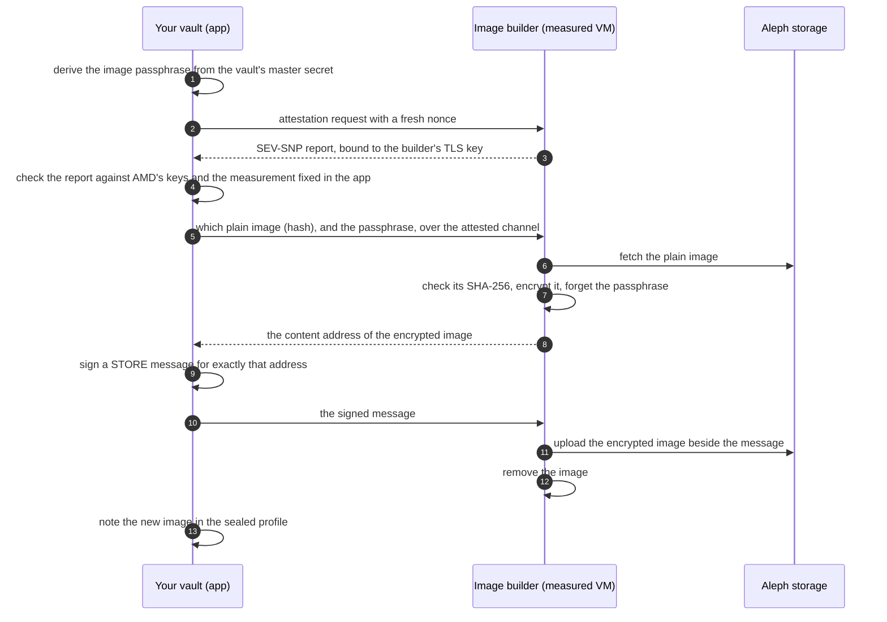

# Your own image

> **Status: in preparation.** The image builder exists and is tested in a
> container ([`builder/`](../builder/)). It does not run on Aleph yet, and the
> app does not use it yet; the list at the end says what is missing. Until
> then every image version has one passphrase, as
> [keys and recovery](keys-and-recovery.md) describes.

A VM of Paperless anywhere boots from an encrypted image. The measured part
of the boot (firmware, kernel, initrd) opens that image with a passphrase the
app hands over after the attestation, and then starts what it finds inside.

With an image of your own, that passphrase comes from your vault and nobody
else has it. The disk your VM opens is then the image that was sealed for
you, and nothing else: a disk that was not sealed with your passphrase does
not open, and the VM does not start.

## The pieces

| Piece | What it is | Who can check it |
|---|---|---|
| The plain image | Debian, Docker, Caddy, the scripts: what `rootfs/build-image.sh` builds. It holds no secret and is public on Aleph. | Everyone: its SHA-256 is fixed in the app and printed by the build. |
| The image builder | A small service that encrypts the plain image with a passphrase it is given. It runs in a confidential VM whose whole content is measured (an Aleph V-PROGRAM). | Everyone: its launch measurement is fixed in the app and can be recomputed from this repository. |
| Your app | Derives the passphrase from your vault, checks the builder's attestation, signs for the storage. | You. |
| Your image | The plain image, encrypted with your passphrase, stored on Aleph under your vault's address. | Only your vault can open it. |

## How an image is made



Steps 2 to 4 are the same check the app makes before it unlocks a Paperless
VM ([workflow, section 3](workflow.md#3-attestation-and-unlock-in-detail)):
no passphrase leaves the app before the hardware has confirmed what runs on
the other side.

## Why the VM can only start your image


Two checks by hardware, one secret between them:

1. The **builder** is measured as a whole (its firmware, kernel, initrd, and
   through dm-verity root hashes on the boot line also its root filesystem
   and its workload). The app accepts one measurement only, so the passphrase
   reaches the code in this repository and no other.
2. The **Paperless VM** is measured up to the initrd that opens the disk, as
   today. That initrd accepts the passphrase only with the owner's signature.
3. The **passphrase** exists in your vault, for the minutes of a build in the
   builder's memory, and at a start in your VM's memory.

## Who knows the passphrase

| | Knows it |
|---|---|
| Your vault | yes: it derives it, under its own label, from the master secret |
| The image builder | during one build, in memory; it goes to `cryptsetup` on standard input and is in no file, no log and no answer |
| Your VM | at boot, to open the disk; the VM zeroes it afterwards |
| Le Space | no |
| The node that runs the builder or your VM | no: both run in SEV-SNP guests |
| GitHub, the build workflow | no |
| Another person using Paperless anywhere | no |

## What can be compared in public

- **The plain image:** one SHA-256 for everyone. The build prints it, the app
  names it, and anyone can download the image and hash it.
- **The builder:** one launch measurement for everyone, computed from the
  runtime Aleph publishes and the builder's root hashes. The app shows the
  one it accepts.
- **Not the encrypted image:** it differs for every person, because the
  passphrase and the random disk key differ. Its hash says nothing to anyone
  else, and nothing checks it at boot. What makes it yours is that it opens
  with your passphrase.

The encryption (LUKS2, AES-XTS) keeps the content secret and makes it
impossible to craft content without the passphrase. It does not notice
blocks that were damaged on purpose: such a VM fails or misbehaves, but it
cannot be made to run a chosen program.

## The builder's interface

It listens on `127.0.0.1:8080` in its VM; Aleph's attestation agent is the
only way in and forwards from the attested TLS port.

| Call | Does |
|---|---|
| `POST /build` `{store, sha256, passphrase}` | Fetches the plain image named by `store` from Aleph, refuses it unless its SHA-256 is `sha256`, encrypts it. Answers `{job}` at once. |
| `GET /job/<job>` | `{state}`: `building`, `built` (with the content address and size), `failed`, `published`. |
| `POST /job/<job>/publish` `{message}` | Uploads the image beside the signed STORE message, only if the message names exactly the built file. Then removes the image. |

It builds one image at a time, takes the plain image from Aleph only, holds
no key of its own (your app signs and your vault's address pays the
storage), and removes an image nobody fetched after 20 minutes.

## What it costs

One build per image version and person: a few minutes, and the storage of
the encrypted image (under 1 GiB) on your vault's address, as long as you
use that version. An older image can be forgotten once the new one has
started.

## Publishing the plain image

The image workflow (`rootfs.yml`) does it with the option **plain**: it
converts the image as for an encrypted one, publishes it as a STORE of its
own and prints the STORE's hash and the image's SHA-256 in the run's
summary. These two values are what the app will name to the builder.

## Trying the builder

```sh
cd builder
npm test                                  # the rules above, without a container
docker build -f Containerfile -t image-builder .
docker run --rm -v "$PWD/check-container.mjs:/opt/builder/check-container.mjs:ro" \
  image-builder node check-container.mjs  # one whole job against a stand-in for Aleph
```

## Before it goes live

- The builder runs as a **V-PROGRAM** on Aleph. Compose file, image archive
  and the steps are prepared in
  [`builder/vprogram/`](../builder/vprogram/README.md), with a workflow
  that measures, publishes, checks and deletes it; the first run has to
  show the outbound network, that one image fits into the VM's memory (the
  root filesystem is read-only, the scratch space is memory), and the
  upload.
- The builder's **measurement** comes from that publication (the Aleph CLI
  computes it and writes it into the V-PROGRAM message) and is then fixed
  in the app, as the runtime of a Paperless VM is.
- The builder and the plain image are **fixed in the app** (`BUILDER` in
  `pwa/src/lib/own-image.js`). The step "Mein Image bauen" in the setup is
  written and shows up once they are; how an attest relay reaches a
  V-PROGRAM is still to be tried.
- The landing page and the security model say so once all of this is true.
