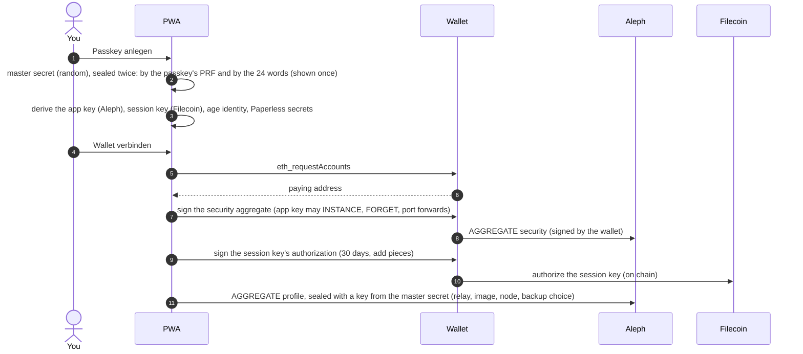
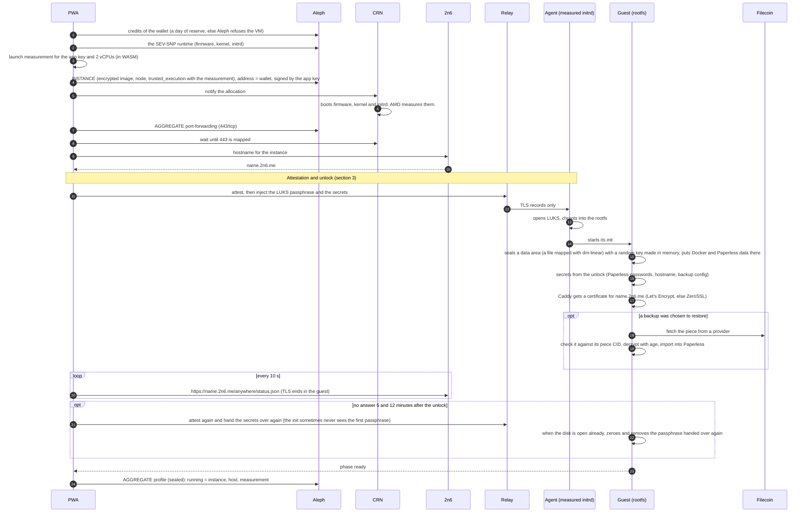
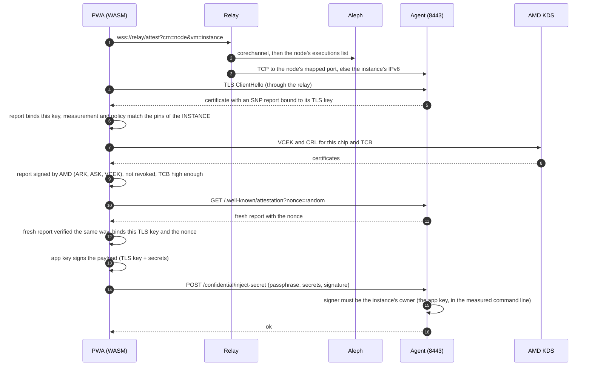
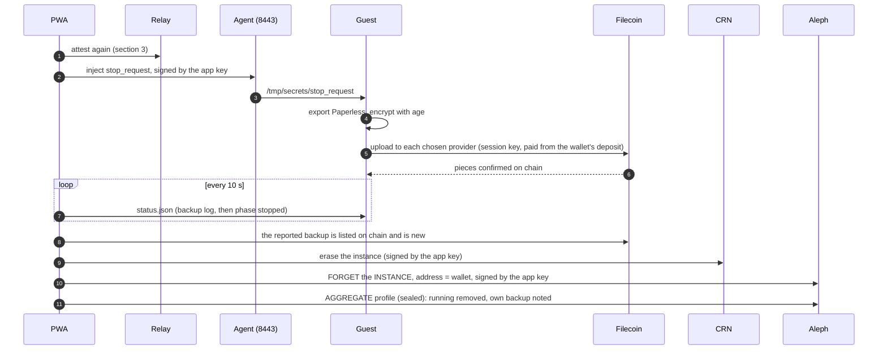
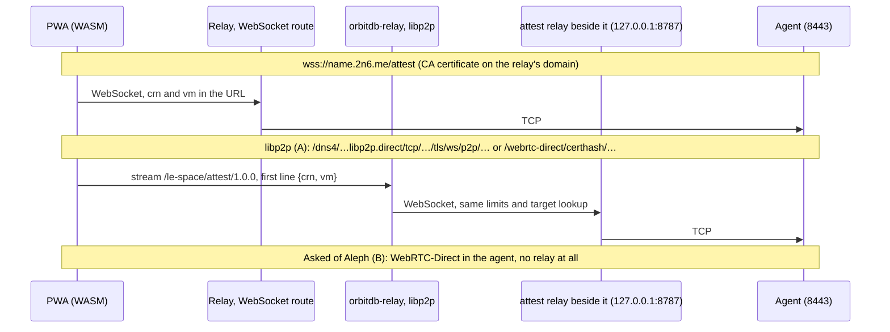

# The workflow, step by step

How a confidential Paperless is set up, started, attested, unlocked, backed up and erased, as the code does it today (PWA `pwa/src/lib/lifecycle.js`, relay-button's `@le-space/attest-wasm`, the guest scripts in `rootfs/files/`). Keys and recovery, with the vault's own diagrams (what comes from where, create, open, add a passkey): [keys-and-recovery.md](keys-and-recovery.md#the-vault-step-by-step). Deploying the PWA: [deploy.md](deploy.md).

**Who takes part**

| | |
|---|---|
| **PWA** | the app in your browser (paperless.le-space.de). Keys live in memory only, after the passkey or the 24 words. |
| **Wallet** | the paying account (MetaMask). It holds the money and signs twice, once per authorization. |
| **Aleph** | the network's API (messages, aggregates, the corechannel list of nodes). |
| **CRN** | the SEV-SNP compute node that runs the VM and maps its ports. |
| **2n6** | gives the VM a name `*.2n6.me` and passes TLS through by SNI. It never ends TLS. |
| **Relay** | the attest relay: WebSocket ↔ TCP to the guest's port 8443. It sees TLS records only. |
| **AMD KDS** | AMD's key distribution service: the chip's certificate (VCEK) and the revocation list. |
| **Agent** | `aleph-attest-agent` in Aleph's measured initrd. It answers on 8443 before the disk is open. |
| **Guest** | our encrypted rootfs after the unlock: Caddy, Paperless, the backup tool. |
| **Filecoin** | the storage providers and the chain (Filecoin Pay, data sets). |
| **Cloudflare** | only with a DNS token in the profile (fixed address): the VM sets its own A/AAAA records and the ACME TXT record there. |

## 1. Setup (once)

The app key and the session key hold no money. They act on behalf of the wallet, which pays.

## 2. Start

**With a fixed address** (a Cloudflare token in the profile, #26), steps 68–69 are replaced: the name is `<label>.vm.le-space.de`, derived from the master secret, the same at every start. The token, the node's IPv4 and its port for 443 go with the secrets. The guest points the name at itself (AAAA: its IPv6, A: the node's IPv4), gets the certificate with lego over DNS-01 (no 2n6, no inbound port for the challenge), and Caddy answers on 443 and on the node's port. The app uses `name:port`, which reaches the VM from IPv4 and IPv6, and looks at the status page only 90 s after the unlock: asked earlier, the zone's wildcard answers and the browser keeps that answer for minutes. The token can change every record of the zone; it lives in the sealed profile and goes only to the VM.

The guest takes the fixed name's certificate from the backup to restore first, and waits for that backup's download before it orders anything; it orders a new one only when neither the VM nor the backup has one, and renews one with less than 30 days left (Let's Encrypt issues at most five per name and week, `paperless-fixed-address`). Until the fixed name has its certificate, Caddy serves the status page (and nothing else) over the instance's 2n6 name: the guest does not know that name, so Caddy orders its certificate on demand, at the first handshake that arrives through 2n6, and `paperless-2n6-ask` allows it only for a name that 2n6's lookup routes to this VM's IPv6. The app reads the status page there while the fixed name does not answer. The page says which step the start waits for (`waiting`: `data-area`, `dns`, `certificate`, `restore-download`, `restore-import`, `images`, `containers`, `paperless`), and `address-failed` when the guest gave the fixed address up; the app says plainly what waits once a step takes too long.

## 3. Attestation and unlock, in detail

All checks run in the browser (`@le-space/attest-wasm`, rustls and the AMD verification in WASM). The relay carries bytes it cannot read.

Only the nonce leaves the browser before the attestation holds. The passphrase and the secrets go out after it, signed for exactly this TLS key.

## 4. Stop: last backup, then erase

Before it erases anything, the app checks the status page's word against the chain: it lists the backups on chain before it sends the stop, and afterwards waits (up to two minutes) until the backup the stop reports is listed there and was not listed before. A stop that made no piece of its own, because a backup finished just before it, counts only when the chain lists a backup that was not there before the stop. If not, the VM stays, with a message, and the stop can be tried again. "Delete the VM anyway" after a partial backup makes the same check.

Without a backup choice, the stop is ready at once. "My VMs" erases a VM without the last backup. A backup that already runs when the stop comes (a check, or "Back up now") finishes first (up to 30 minutes); the stop's own backup is then a check that uploads only what changed since.

**A restore fails.** Paperless then runs empty (phase `restore-failed`), and a backup of it would become the newest one: the next start would restore that. So `paperless-backup` refuses every backup while `restore.json` says `failed` (status `refused`): a scheduled backup, "Back up now" and the stop's last backup, also of what was added to that Paperless since. The app says so, offers no "Back up and stop" for such a VM, only **Delete without a backup**, and asks before it erases and forgets the VM, naming what its documents take up now. The last good backup stays the newest.

`stop.json` names the request it answers, so the app never takes an earlier stop's outcome for the one it just sent (the VM picks a new request up within seconds; an older image is told apart by the time of its answer).

**A provider refuses the piece.** The backup tool goes on without it: the others get their copies, and the backup is marked incomplete. `paperless-backup` reports `partial` (exit 2) and does not record the fingerprint, so the next scheduled backup asks every provider again. In a stop, `paperless-stop` answers `partial` (phase `stop-partial`), keeps Paperless paused and erases nothing. The app says how many copies arrived and asks: "Delete the VM anyway" erases it as after a full backup; "Keep the VM" injects `stop_resume` naming the partial stop's request (an old one never restarts Paperless after a later stop), Paperless starts again (`resumed`) and the VM stays. The question also shows when the app is opened later. No copy at all is still a failure: Paperless starts again and the VM stays.

### The end of the paid time

A voucher's period, or a package cancelled at its period's end, does not renew. After it the VM would run on Aleph's start reserve until the sub-account's credits are used up, and Aleph would stop it with whatever came in since the last scheduled backup. So the app hands the VM the end as the secret `period_end` (Unix seconds; `0` when the plan renews, when the app's address or a wallet pays the VM, or without backups), at the start, with every hand-over of the backup places, and again at an opening when it changed (a new voucher, a renewal, hours bought). The end is the period's end, or earlier when the plan's hours run out (`pwa/src/lib/period-end.js`).

One hour before it, `paperless-period-end` tells `paperless-stop` to stop as for "Back up and stop": Paperless pauses, the last backup goes up. Its request is `period-end-<time>`, and `stop.json` says `"reason":"period-end"` (the app's own stop: `"app"`). A failed backup starts Paperless again and is tried again after 15 minutes; a partial one waits for the person as above. Not while a restore runs.

The status pages say `stopReason` (`app` or `period-end`) while a stop runs or after it; the public page names nothing else, the private one also the `periodEnd` the VM holds. At its next opening the app finds the phase `stopped` with reason `period-end`, checks that the stop's backup is on the chain and is new (or, when the stop found nothing new, the backup that was running when it began), then erases and forgets the VM as after "Back up and stop". Nobody erases it while the app stays closed: Le Space's terms (version 4) say Le Space does not stop a VM itself. Until then the paused VM uses the reserve, which Le Space Credits takes back three days after the end.

The overview and the package card warn three days before the end, urgently on the last day.

### Auto-stop

The person may let the VM stop itself after a quiet time or daily at an hour (`docs/auto-stop.md`). The setting lives in the sealed profile (`autoStop`: `idleMinutes`, `dailyAt`, the browser's IANA zone `tz`, `postponeUntil`); the app hands it over as the secret `auto_stop` (with the zone's current UTC offset) at the start, with every hand-over of the backup places, when the person changes or postpones it, and at an opening when the VM holds another one. It is only sent with backups, and it is the first optional secret to go when a start would carry more than 16 (the app then says so); `paperless-auto-stop` decides when it is due (no request to Paperless through Caddy for the chosen minutes, apart from the polls of an open tab; or the daily hour in the person's time zone, after ten quiet minutes; never while Paperless still consumes or a restore runs), and `paperless-stop` makes the same stop as above with the reason `idle` or `schedule`, after the period end. Images that can do this say `autoStop` in their capabilities. While the app is open it reads the private page's `autoStop` (when each stop is due) and warns ten minutes before, with "1 hour later". At the next opening it erases a VM stopped with `idle` or `schedule` as after a period-end stop, once its last backup is on the chain. Until the VM can forget itself (phase 3), the paused VM costs as much as a running one until then, and the app says so next to the setting.

### Backup now, while Paperless runs

"Back up now" in the overview takes the same way as the stop: attest again, then inject `backup_request`, signed by the app key. `paperless-backup-loop` sees the new value within seconds and runs `paperless-backup run` (or `check`, when another backup holds the lock or finished after the request came, so the same state is not uploaded twice). The VM keeps running. The private status page carries `backupRequest` (the request's outcome), `lastBackup` (the last backup that ran, done, partial or failed, kept across the checks that find nothing new) and `backupSchedule.nextCheck`; the overview reads them every minute.

## 5. The relay: WebSocket or libp2p

The setting holds one or more relays, tried in turn: a `wss://…/attest` URL, or the multiaddr of an orbitdb-relay that speaks `/le-space/attest/1.0.0`. The libp2p way needs no domain of the relay's own. The relay reaches the browser over WebSockets with an AutoTLS certificate (`*.libp2p.direct`), or WebRTC-Direct where the relay offers it.

Why a relay at all: a browser cannot open raw TCP. From an `https://` page it opens WebSockets only with `wss://` and a CA certificate. The agent has neither before the unlock, only its self-signed RA-TLS certificate, whose report the WASM has to check itself. WebRTC needs no CA, only the certificate's fingerprint. On Aleph VMs the orbitdb-relay's WebRTC-Direct listener does not come up today, so the libp2p way uses AutoTLS WebSockets there. Background and plan: [NiKrause/relay-button#200](https://github.com/NiKrause/relay-button/issues/200), [aleph-im/aleph-vm#1314](https://github.com/aleph-im/aleph-vm/issues/1314).
