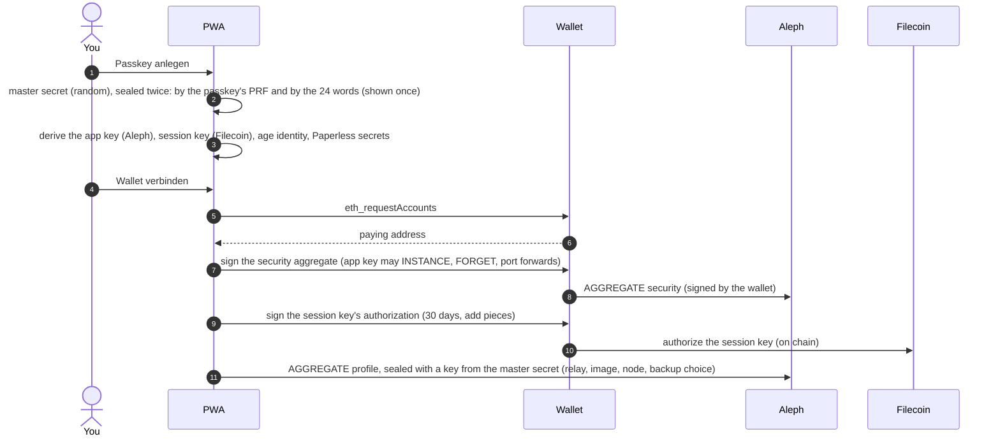
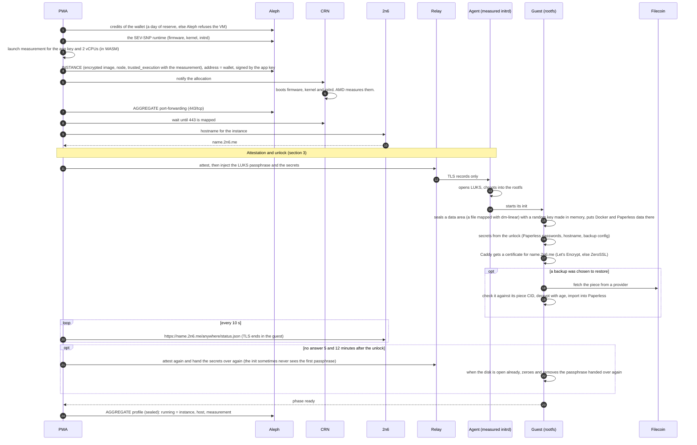
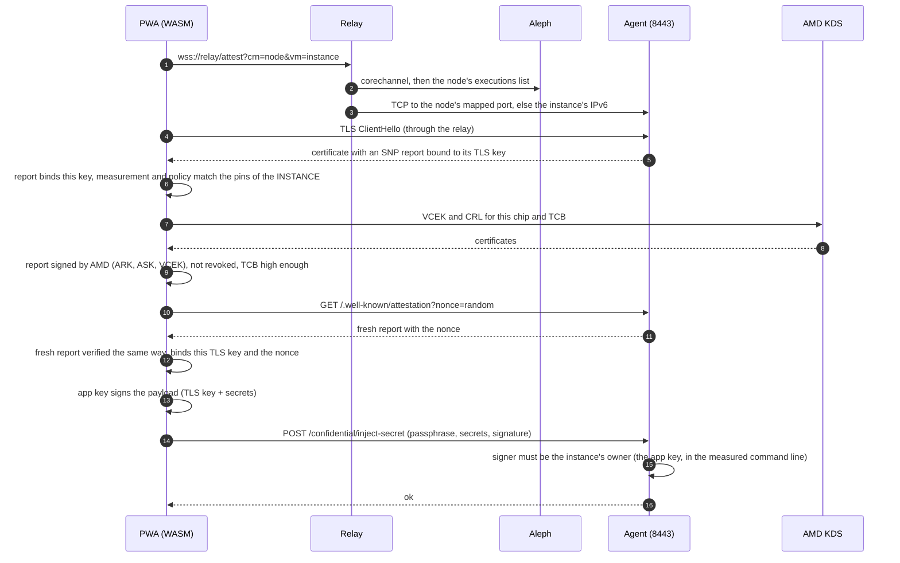
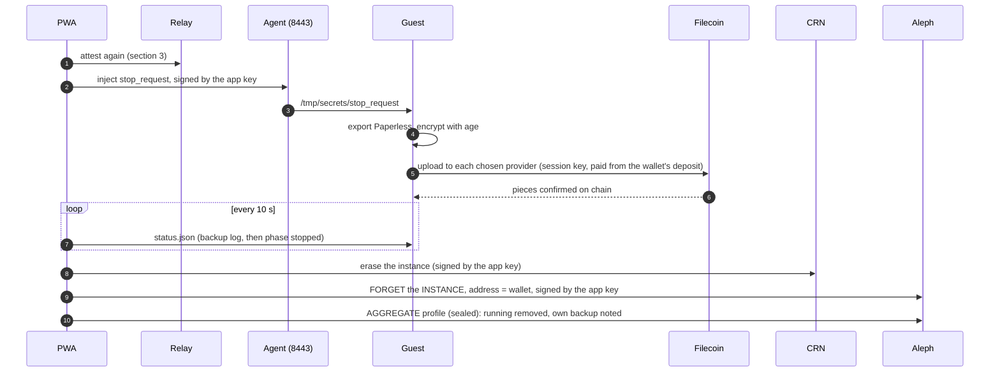
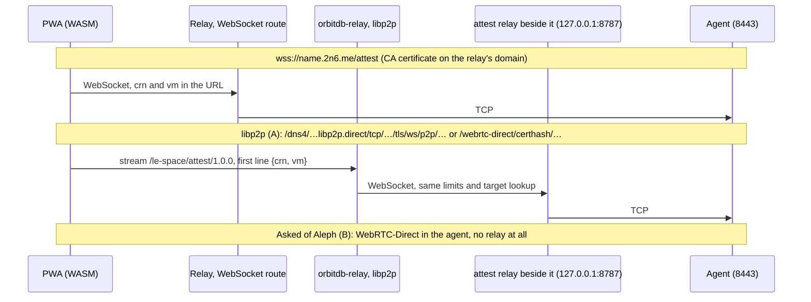

# The workflow, step by step

How a confidential Paperless is set up, started, attested, unlocked, backed up and erased, as the code does it today (PWA `pwa/src/lib/lifecycle.js`, relay-button's `@le-space/attest-wasm`, the guest scripts in `rootfs/files/`). Keys and recovery, with the vault's own diagrams (what comes from where, create, open, add a passkey): [keys-and-recovery.md](keys-and-recovery.md#the-vault-step-by-step). Deploying the PWA: [deploy.md](deploy.md).

**Who takes part**

| | |
|---|---|
| **PWA** | the app in your browser (paperless.le-space.de). Keys live in memory only, after the passkey or the 24 words. |
| **Wallet** | the paying account (MetaMask). It holds the money and signs twice, once per authorization. |
| **Aleph** | the network's API (messages, aggregates, the corechannel list of nodes). |
| **CRN** | the SEV-SNP compute node that runs the VM and maps its ports. |
| **2n6** | gives the VM a name `*.2n6.me` and passes TLS through by SNI. It never ends TLS. |
| **Relay** | the attest relay: WebSocket ↔ TCP to the guest's port 8443. It sees TLS records only. |
| **AMD KDS** | AMD's key distribution service: the chip's certificate (VCEK) and the revocation list. |
| **Agent** | `aleph-attest-agent` in Aleph's measured initrd. It answers on 8443 before the disk is open. |
| **Guest** | our encrypted rootfs after the unlock: Caddy, Paperless, the backup tool. |
| **Filecoin** | the storage providers and the chain (Filecoin Pay, data sets). |
| **Cloudflare** | only with a DNS token in the profile (fixed address): the VM sets its own A/AAAA records and the ACME TXT record there. |

## 1. Setup (once)

The app key and the session key hold no money. They act on behalf of the wallet, which pays.

## 2. Start

**With a fixed address** (a Cloudflare token in the profile, #26), steps 68–69 are replaced: the name is `<label>.vm.le-space.de`, derived from the master secret, the same at every start. The token, the node's IPv4 and its port for 443 go with the secrets. The guest points the name at itself (AAAA: its IPv6, A: the node's IPv4), gets the certificate with lego over DNS-01 (no 2n6, no inbound port for the challenge), and Caddy answers on 443 and on the node's port. The app uses `name:port`, which reaches the VM from IPv4 and IPv6, and looks at the status page only 90 s after the unlock: asked earlier, the zone's wildcard answers and the browser keeps that answer for minutes. The token can change every record of the zone; it lives in the sealed profile and goes only to the VM.

## 3. Attestation and unlock, in detail

All checks run in the browser (`@le-space/attest-wasm`, rustls and the AMD verification in WASM). The relay carries bytes it cannot read.

Only the nonce leaves the browser before the attestation holds. The passphrase and the secrets go out after it, signed for exactly this TLS key.

## 4. Stop: last backup, then erase

Without a backup choice, the stop is ready at once. "Meine VMs" erases a VM without the last backup.

### Backup now, while Paperless runs

"Jetzt sichern" in the overview takes the same way as the stop: attest again, then inject `backup_request`, signed by the app key. `paperless-backup-loop` sees the new value within seconds and runs `paperless-backup run` (or `check`, when another backup holds the lock or finished after the request came, so the same state is not uploaded twice). The VM keeps running. The private status page carries `backupRequest` (the request's outcome), `lastBackup` (the last backup that ran, done or failed, kept across the two-hourly checks that find nothing new) and `backupSchedule.nextCheck`; the overview reads them every minute.

## 5. The relay: WebSocket or libp2p

The setting holds one or more relays, tried in turn: a `wss://…/attest` URL, or the multiaddr of an orbitdb-relay that speaks `/le-space/attest/1.0.0`. The libp2p way needs no domain of the relay's own. The relay reaches the browser over WebSockets with an AutoTLS certificate (`*.libp2p.direct`), or WebRTC-Direct where the relay offers it.

Why a relay at all: a browser cannot open raw TCP. From an `https://` page it opens WebSockets only with `wss://` and a CA certificate. The agent has neither before the unlock, only its self-signed RA-TLS certificate, whose report the WASM has to check itself. WebRTC needs no CA, only the certificate's fingerprint. On Aleph VMs the orbitdb-relay's WebRTC-Direct listener does not come up today, so the libp2p way uses AutoTLS WebSockets there. Background and plan: [NiKrause/relay-button#200](https://github.com/NiKrause/relay-button/issues/200), [aleph-im/aleph-vm#1314](https://github.com/aleph-im/aleph-vm/issues/1314).
